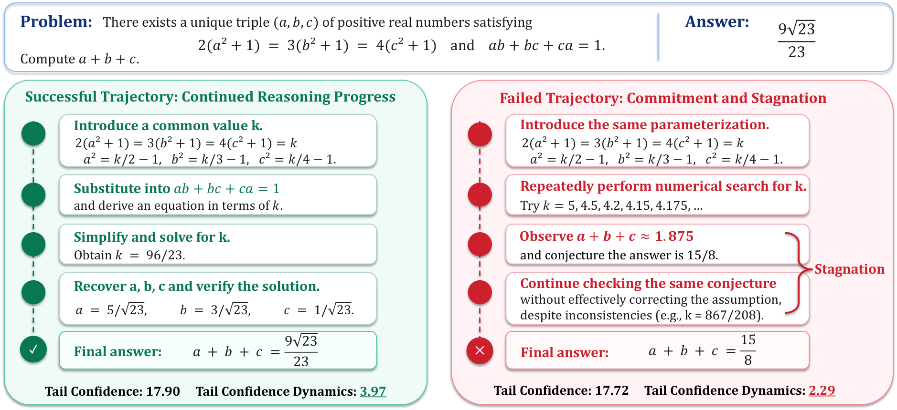

# Confidence Dynamics for Test-Time Reasoning

Training-free test-time scaling that votes with **inter-layer confidence dynamics**, not only final-layer confidence.

> *Beyond Final Confidence: Leveraging Confidence Dynamics for Test-Time Reasoning*
> Siyuan Wang, Xiang Ren, Weiyang Liu.
> [`docs/paper.pdf`](docs/paper.pdf)



A failed trajectory can stay as confident as a correct one while it stops making progress. The extra signal is how much the final layer updates that confidence.

## Confidence dynamics

At decode step \(t\), final-layer token confidence follows DeepConf with \(k = 20\):

\[
C_t^{(L)} = -\frac{1}{k}\sum_{j=1}^{k}\log p_t^{(L)}(j)
\]

Inter-layer confidence dynamics is the change from the penultimate layer:

\[
\Delta C_t = C_t^{(L)} - C_t^{(L-1)}
\]

A trajectory uses the mean over all generated tokens, or over the last 2,048 tokens (the tail, written \(C^{T}\) and \(\Delta C^{T}\)).

Voting weights a trajectory by its score. A dynamics pool that contains a negative weight is shifted by its minimum; an all-positive pool is left unchanged. If every weight is still non-positive, the vote falls back to majority:

\[
w_i = \Delta C(\tau_i) - \min_j \Delta C(\tau_j), \qquad
\hat{a} = \arg\max_a \sum_i w_i \mathbf{1}[a_i = a]
\]

Confidence decides which trajectories stay when a filter is used. Dynamics decides how much each retained trajectory counts.

## Overall accuracy (%)

| Model | Standard | CW | \(C^{T}W\) | DW | \(D^{T}W\) |
|---|---:|---:|---:|---:|---:|
| Qwen3-1.7B | 44.84 | 45.99 | 45.91 | 46.66 | **47.88** |
| Qwen3-8B | 65.05 | 66.04 | 65.99 | 66.73 | **68.11** |
| Nemotron-3-Nano-4B | 51.46 | 51.69 | 51.81 | 52.59 | **53.87** |

Keeping the top 50% by confidence, then voting:

| Model | CF-CW | \(C^{T}\)F-\(C^{T}W\) | CF-\(D^{T}W\) | \(C^{T}\)F-\(D^{T}W\) |
|---|---:|---:|---:|---:|
| Qwen3-1.7B | 48.37 | 48.14 | **49.84** | 49.24 |
| Qwen3-8B | 68.40 | 68.22 | 68.71 | **69.09** |
| Nemotron-3-Nano-4B | 52.74 | 54.21 | 55.25 | **56.16** |

> Each problem draws \(N = 50\) trajectories; length-capped traces are dropped. Accuracy is the mean over 20 windows of 30 traces from that pool, then the macro-average of GPQA-Diamond, HMMT, AIME, SuperGPQA, and Countdown6. 

## Setup

`configure.sh` installs PyTorch 2.13 (`TORCH_CUDA=cu129`, or `cu126`) and the vendored SGLang in `sglang_pkg/`.

```bash
conda create -n confdyn python=3.12 -y --override-channels -c conda-forge
conda activate confdyn
cd /path/to/confidence-dynamics
bash configure.sh
```

Models go in `MODELS_DIR` (default `../models`): [Qwen3-1.7B](https://huggingface.co/Qwen/Qwen3-1.7B), [Qwen3-8B](https://huggingface.co/Qwen/Qwen3-8B), [NVIDIA-Nemotron-3-Nano-4B-BF16](https://huggingface.co/nvidia/NVIDIA-Nemotron-3-Nano-4B-BF16). Benchmarks are in [`datasets/`](datasets/README.md).

## Run

```bash
CUDA_VISIBLE_DEVICES=0,1 TP_SIZE=1 DP_SIZE=2 \
  MODELS_DIR=/path/to/models \
  MODELS="Qwen3-1.7B Qwen3-8B NVIDIA-Nemotron-3-Nano-4B-BF16" \
  DATASETS="gpqa_diamond hmmt aime sgpqa200 countdown6all" \
  bash scripts/run_main_table.sh
```

Dumps land in `results/<dataset>_n1000/n50_<model>_t<T>_k<K>_p0.95_mt<max_tokens>.json`. The script then scores them. `SCORE=0` writes dumps only.

**Decoding hyperparameters:** Top-\(p\) is 0.95 and the repetition penalty is 1; Qwen3 uses temperature 0.6, top-\(k\) 20, and presence penalty 1.5, except Countdown6 at temperature 1.0; Nemotron uses temperature 1.0, top-\(k\) off, and presence penalty 0; HMMT and AIME allow 40,000 new tokens; the other three benchmarks allow 32,768.

## Aggregate

```bash
python scripts/score_main_table.py \
  --models Qwen3-1.7B Qwen3-8B Nemotron-3-Nano-4B \
  --datasets gpqa_diamond hmmt aime sgpqa200 countdown6all
```

Standard is majority vote. CW and \(C^{T}W\) weight by global or tail confidence. DW and \(D^{T}W\) weight by global or tail \(\Delta C\), using the shift above. Top 80% and top 50% first keep \(\lceil \rho N \rceil\) traces (at least one) by global or tail confidence, then weight that subset by the same confidence, or by tail \(\Delta C\). Ties keep the earliest trajectory.

## Citation

```bibtex
@article{wang2026confidence,
  title   = {Beyond Final Confidence: Leveraging Confidence Dynamics for Test-Time Reasoning},
  author  = {Wang, Siyuan and Ren, Xiang and Liu, Weiyang},
  year    = {2026}
}
```

```bibtex
@article{fu2025deep,
  title   = {Deep Think with Confidence},
  author  = {Fu, Yichao and Wang, Xuewei and Tian, Yuandong and Zhao, Jiawei},
  journal = {arXiv preprint arXiv:2508.15260},
  year    = {2025}
}
```

## License

Project code is [MIT](LICENSE). `sglang_pkg/` is [Apache-2.0](sglang_pkg/LICENSE).
